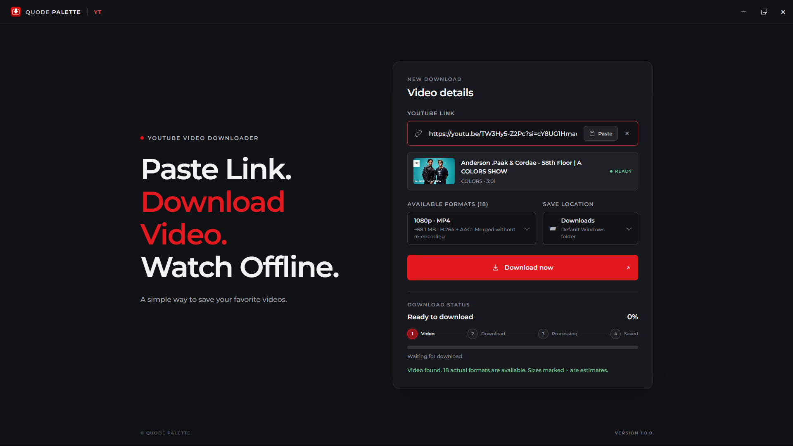
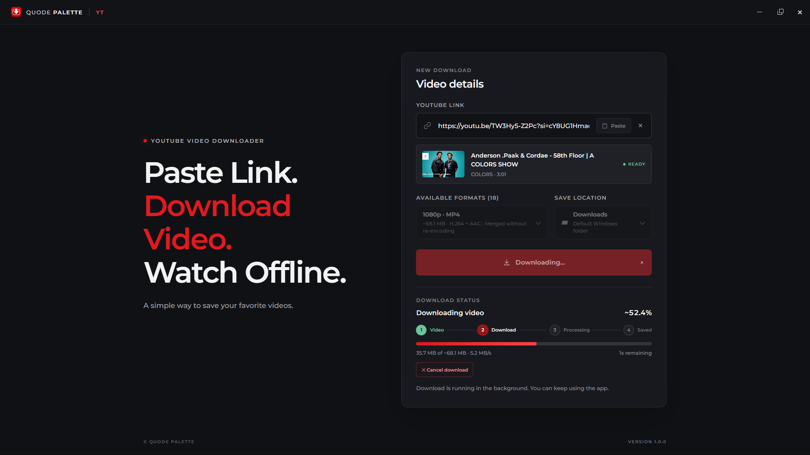
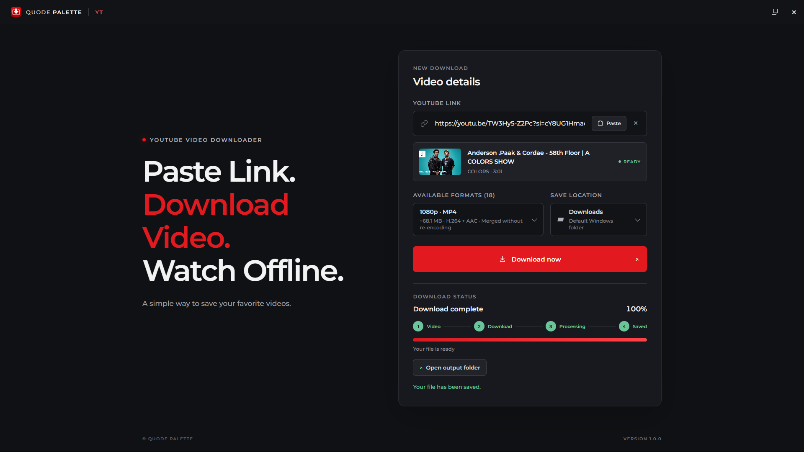

# Quode Palette YT

A lightweight Windows desktop app for downloading YouTube videos and audio.

  
  <b>Screenshot I</b>

<table>
    <td width="50%" align="center">
      
       
      <b>Screenshot II</b>
       
      <!-- Convert common audio formats with FFmpeg -->
    </td>
    <td width="50%" align="center">
      
       
      <b>Screenshot III</b>
       
      <!-- Convert common video formats with FFmpeg -->
    </td>
</table>

## Download

Get `Quode-Palette-YT.exe` from the [Releases](../../releases) page. It is a single portable file with yt-dlp baked in: no installer, no extra files.

## Requirements

- Windows 10 or later
- Microsoft Edge WebView2 Runtime (included with Windows 10/11)
- Internet connection
- Optional: place `ffmpeg.exe` beside the exe (or on PATH) to enable merged video and MP3 formats

## Behavior

- Launches instantly; only one instance can run. Starting a second shows "already running" in the first.
- Pasting a link starts the check immediately, using a direct single-request YouTube lookup (no yt-dlp start-up), with yt-dlp as fallback.

## Use

Paste a YouTube link, check the video, choose a video quality or available audio stream, select a save folder, and start the download. The app shows download stages and can open the output folder in Windows Explorer.

Only download content when you have the right to do so. You are responsible for complying with applicable laws and YouTube's terms.

## Credits

Quode Palette YT uses [yt-dlp](https://github.com/yt-dlp/yt-dlp) for media retrieval and Montserrat for its interface typography. See `THIRD_PARTY_NOTICES.md` for notices.

## License

Released under the [PolyForm Noncommercial License 1.0.0](LICENSE). You are free to use, modify and share it for personal, educational and other noncommercial purposes. For commercial use, please get in touch.
[Email Us](mailto:hello@quodepalette.com)

Copyright © Quode Palette
